# c975L

Open-source Symfony bundles for building websites — a shared EasyAdmin back-office, database-backed
configuration, composable page blocks, e-commerce and more, each bundle usable on its own but designed
to plug into the others.

Maintained by [Laurent Marquet](https://github.com/LaurentMarquet) · PHP 8.4 · Symfony 8 · EasyAdmin 5 · MIT

**[Showcase](https://bundles.975l.com/en/) · [Tutorials](https://bundles.975l.com/en/tutoriels) · [Block gallery](https://bundles.975l.com/en/pages/blocks) · [Live demo](https://bundles.975l.com/demo/) · [Demo back-office](https://bundles.975l.com/demo/login)**

<a href="https://bundles.975l.com/demo/">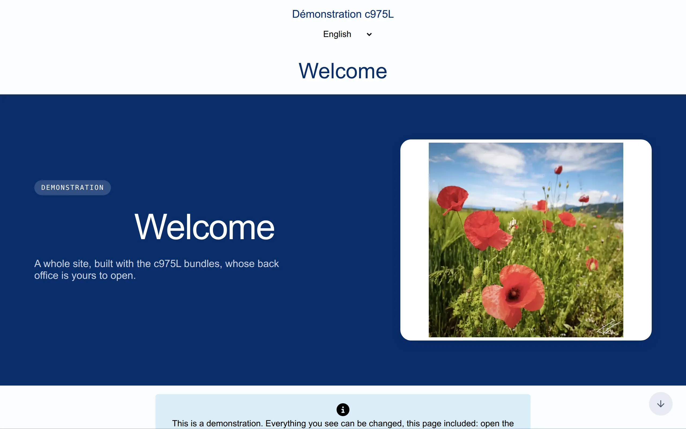</a> <a href="https://bundles.975l.com/demo/login">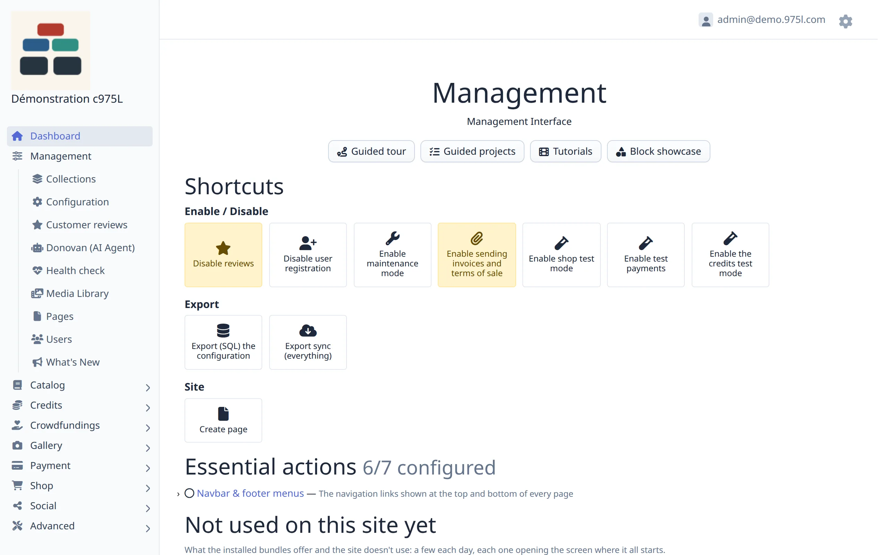</a>

<a href="https://bundles.975l.com/demo/login">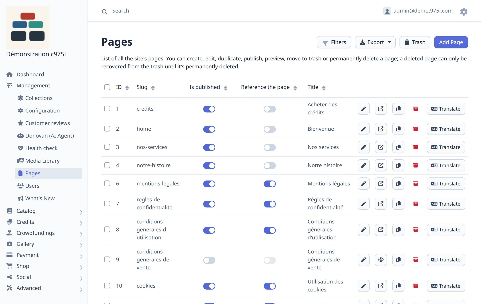</a> <a href="https://bundles.975l.com/demo/login">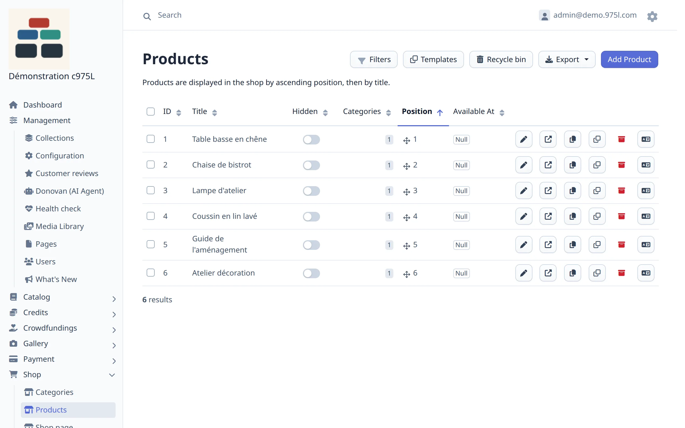</a> <a href="https://bundles.975l.com/demo/login">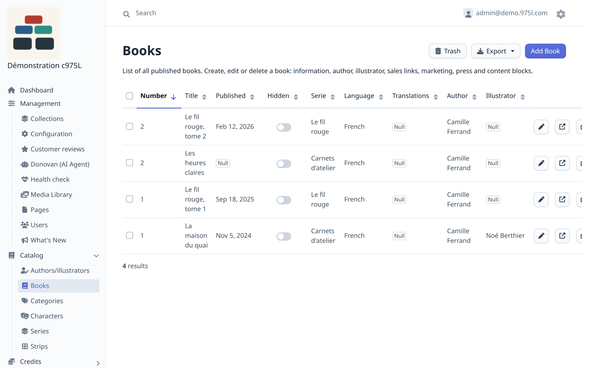</a> <a href="https://bundles.975l.com/demo/login">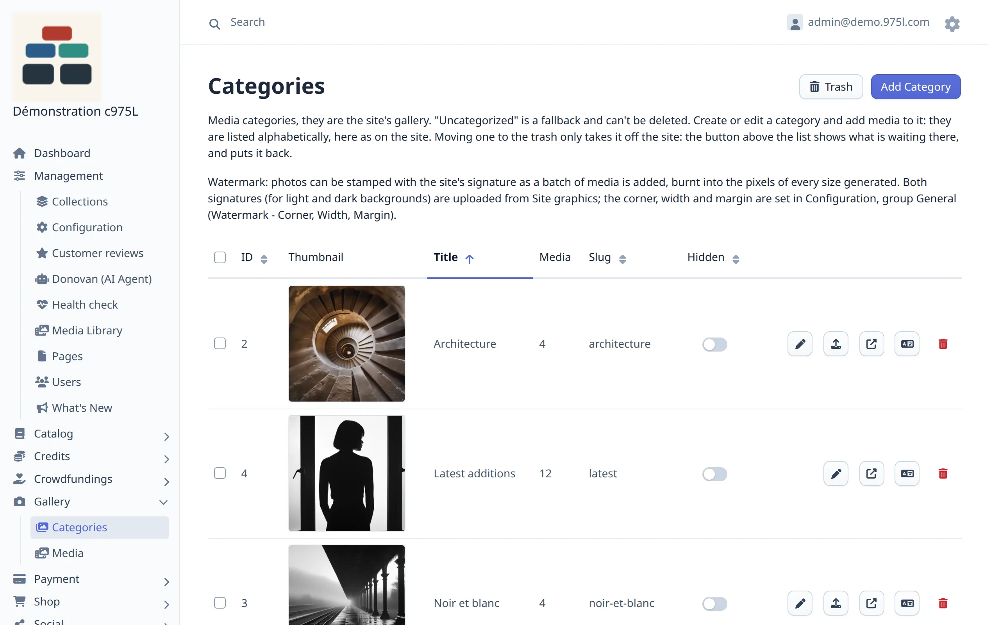</a>

Every bundle has its own [tutorials](https://bundles.975l.com/en/tutoriels): step-by-step walkthroughs, short films, and a question box answered by Donovan, the ecosystem's AI agent, from the bundles' own documentation.

## Made for humans and AI agents

Each README opens on what the bundle does and how to start; its full reference sits folded below. For coding agents, every bundle ships **skills** (`skills/*/SKILL.md`, read straight from `vendor/`), and most expose **MCP tools** on the site's own endpoint (`/api/mcp`, from the core): an agent reads and edits pages, products, books, galleries, posts or project cards with the rights of one account, drafts left for a human to publish.

## The core

| | Package | What it does |
|---|---|---|
| 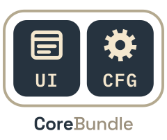 | [CoreBundle](https://github.com/975L/CoreBundle) · [tutorials](https://bundles.975l.com/en/tutoriels/core-bundle)   `c975l/core-bundle` | The base every bundle rests on, two bundles in one package. **ConfigBundle**: configuration stored in the database, the shared `/management` dashboard, accounts, health check, backup, sitemaps, feeds, redirects and the MCP endpoint. **UiBundle**: composable page blocks, media library, editable theme, cookie banner, legal documents, database-driven forms, emails, reviews and shared CSS/JS. |

## The bundles

Each rests on the core alone, plus PaymentBundle when something is paid for. None rests on another.

| | Bundle | What it does | Also requires |
|---|---|---|---|
| 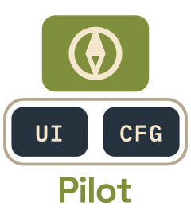 | [PilotBundle](https://github.com/975L/PilotBundle) · [tutorials](https://bundles.975l.com/en/tutoriels/pilot-bundle)   `c975l/pilot-bundle` | Projects piloted as cards inside the site, shared between members: steps, deadlines, feedback with screenshots, steps run by your own machines, and AI agents working on the cards over MCP | — |
| 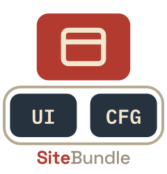 | [SiteBundle](https://github.com/975L/SiteBundle) · [tutorials](https://bundles.975l.com/en/tutoriels/site-bundle)   `c975l/site-bundle` | A complete website: layout, pages composed of blocks, menus, collections, per-page SEO and several languages | — |
| 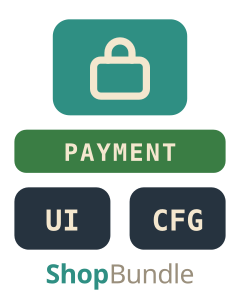 | [ShopBundle](https://github.com/975L/ShopBundle) · [tutorials](https://bundles.975l.com/en/tutoriels/shop-bundle)   `c975l/shop-bundle` | An online shop: products in categories, media, downloadable files, shipping weights and verified buyer reviews | Payment |
|  | [BookBundle](https://github.com/975L/BookBundle) · [tutorials](https://bundles.975l.com/en/tutoriels/book-bundle)   `c975l/book-bundle` | A publisher's catalog: books, series and strips, authors and illustrators, media, press, reader reviews and feeds of what is new | — |
| 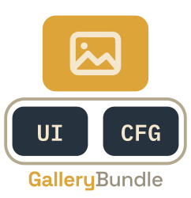 | [GalleryBundle](https://github.com/975L/GalleryBundle) · [tutorials](https://bundles.975l.com/en/tutoriels/gallery-bundle)   `c975l/gallery-bundle` | Photo and video galleries with batch upload and a public viewer, and photographs sold as prints, limited editions included | Payment |
| 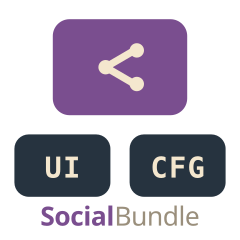 | [SocialBundle](https://github.com/975L/SocialBundle) · [tutorials](https://bundles.975l.com/en/tutoriels/social-bundle)   `c975l/social-bundle` | Posting on Bluesky, Facebook, Instagram, LinkedIn and YouTube from a calendar, every post a draft approved first; plus social links, share buttons and Google reviews | — |
| 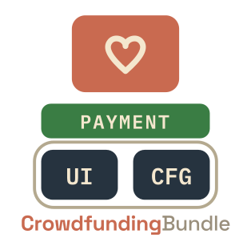 | [CrowdfundingBundle](https://github.com/975L/CrowdfundingBundle) · [tutorials](https://bundles.975l.com/en/tutoriels/crowdfunding-bundle)   `c975l/crowdfunding-bundle` | Crowdfunding campaigns with counterparts, contributors, news and an optional lottery | Payment |
| 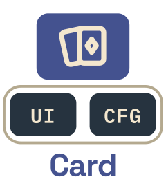 | [CardBundle](https://github.com/975L/CardBundle) · [tutorials](https://bundles.975l.com/en/tutoriels/card-bundle)   `c975l/card-bundle` | Collectible cards on the site's own catalog for a mobile app: what each player holds, card backs won pack by pack, and the API every call of the app starts with | — |
| 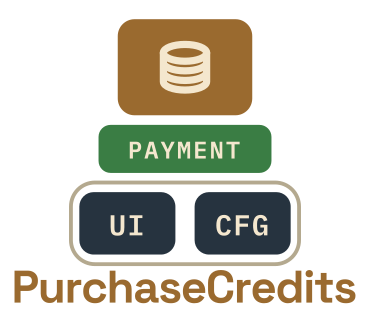 | [PurchaseCreditsBundle](https://github.com/975L/PurchaseCreditsBundle) · [tutorials](https://bundles.975l.com/en/tutoriels/purchasecredits-bundle)   `c975l/purchasecredits-bundle` | Prepaid credits: packs sold through the basket, a ledger per account, and a spending API for the site's own services | Payment |
| 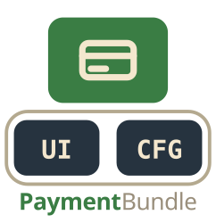 | [PaymentBundle](https://github.com/975L/PaymentBundle) · [tutorials](https://bundles.975l.com/en/tutoriels/payment-bundle)   `c975l/payment-bundle` | The basket and checkout every paid bundle uses: Stripe and Revolut, promotional codes and gift cards, invoices and delivery zones | — |

`composer require c975l/site-bundle` pulls the core in and is usually all you need to start. A site does not need SiteBundle, though: the core plus a shop, a catalog or a gallery is a complete site on its own; SiteBundle adds *pages*, menus and collections.

## Every bundle speaks several languages

**The interface** (back-office, public screens, emails, guided projects) ships in English, French and Spanish, each bundle's tests failing on a key left untranslated.

**The content** is translated as soon as a site names more than one language in Symfony's `enabled_locales`: a page, a product, a book, a gallery or a campaign keeps one row and one slug, its texts said again beside the original on the same edit screen. Other languages answer under `/{_locale}/…`, with `hreflang` in the head and in the sitemaps. A site declaring one language is untouched by all of it.

## The back-office explains itself

A **guided tour** is built from the menus the installed bundles declare, and **guided projects** walk an admin through a real task, highlighting the very button to use, each with its short film. The dashboard also lists what the site does not use yet.

## Start here

New to the ecosystem? Read [CoreBundle's README](https://github.com/975L/CoreBundle#readme) first —
it points at the configuration model and the dashboard extension points (`MenuProviderInterface`,
`AlertProviderInterface`, `ShortcutProviderInterface`, `SitemapProviderInterface`, `FeedProviderInterface`…) that every other
bundle plugs into.

Building a website? Start with [SiteBundle](https://github.com/975L/SiteBundle#readme).

Want to see it running? [bundles.975l.com](https://bundles.975l.com/en/) presents every bundle, its
[block gallery](https://bundles.975l.com/en/pages/blocks) shows every block kind live, and the [demo](https://bundles.975l.com/demo/) is yours to edit.

## Conventions

- Application configuration lives in the database, edited in EasyAdmin — never in `.env`
- The one exception: the languages a site speaks are declared in Symfony's own `enabled_locales`, which the framework itself reads
- A bundle contributes to the dashboard by implementing an interface; no compiler pass to write
- Assets are served through AssetMapper — no npm, no Node, no build step
- Admin controllers live in `Controller/Management/`
- Every bundle is designed to be overridden rather than forked
- A feature belongs to the bundle owning its domain, not to the one that happens to call it

## Archived

Bundles marked archived on this page are no longer maintained. Notably, `ShareButtonsBundle` and
`ContactFormBundle` have been superseded — share buttons moved to
[SocialBundle](https://github.com/975L/SocialBundle), contact forms to the core's database-driven
form system.
